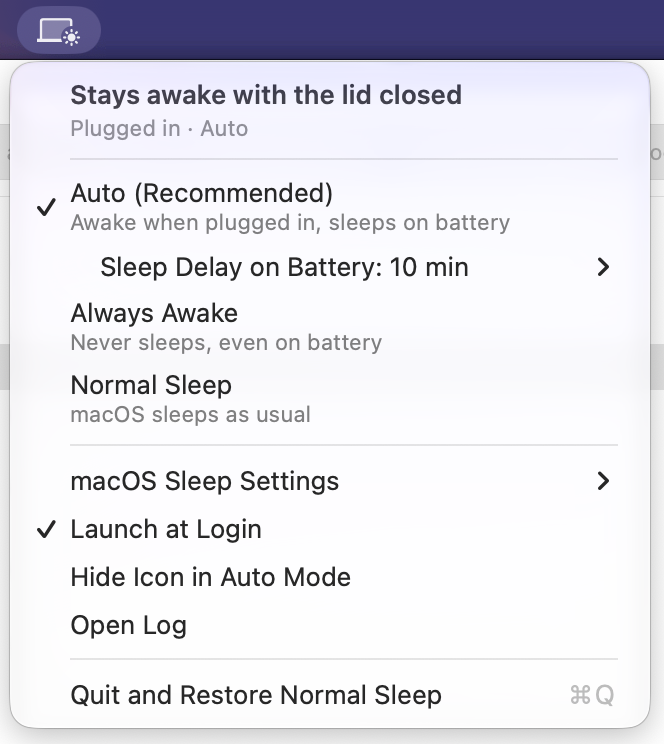
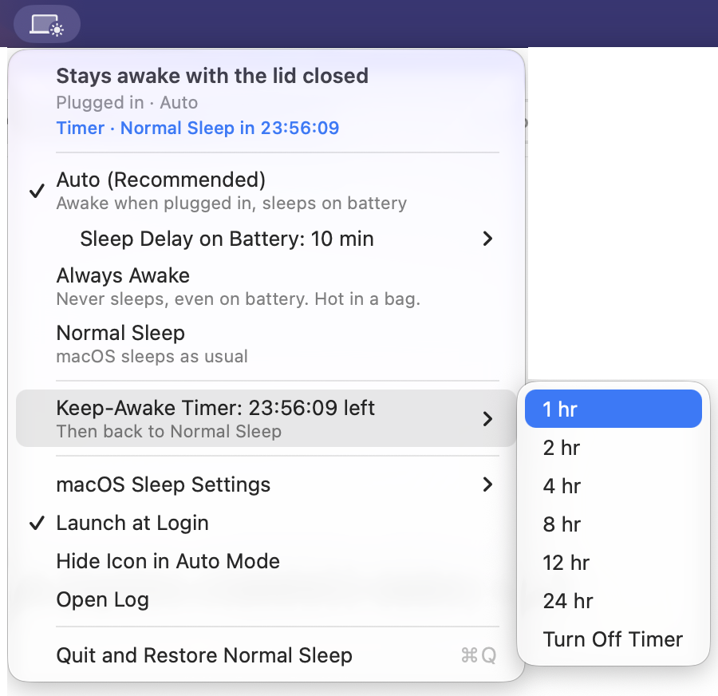

# ClamshellAwake

**Close the lid. Your agents keep running.**

You've seen them: someone walking down the hall with their MacBook held
open in front of them, like a waiter with a tray. They can't close it,
because if the lid shuts, the Mac sleeps and the AI agent on screen stops
mid-task.

ClamshellAwake lets the clamshell close. It's a small menu bar app: when the
Mac is plugged in, it stays awake with the lid closed. You don't need an
external display or a dummy plug. When you unplug it and close the lid, it
goes back to sleep by itself, so it doesn't cook in your bag.



Why an app? macOS sleeps a MacBook as soon as the lid closes, unless an
external display is connected. Its one hidden override, `pmset
disablesleep`, is all or nothing: leave it on, and a MacBook in a bag can't
sleep, gets hot, and runs the battery flat. ClamshellAwake turns it on and
off for you, based on power and the lid.

## Install

1. Download **[ClamshellAwake (DMG)](https://github.com/js-commit/clamshell-awake/releases/latest/download/clamshell-awake-macos.dmg)**.
2. Open the DMG and drag **ClamshellAwake** into **Applications**.
3. Open ClamshellAwake from Applications. A laptop icon appears in the menu bar.
4. Click **Set Up…** and enter your Mac password once. macOS shows a
   generic warning that it "could not verify this script". It shows this
   for every app that asks for admin rights this way. See
   [What the password is for](#what-the-password-is-for) for exactly what
   the script does.

That is all. The app starts again each time you log in.

Requires macOS 13 Ventura or later, on Apple silicon or Intel. The app is
signed and notarized by Apple, so it opens normally.

## Modes

| Mode | Plugged in | On battery |
|---|---|---|
| **Auto** (default, recommended) | Stays awake with the lid closed | When you close the lid, sleeps after the **Sleep Delay on Battery** (default 10 min) |
| **Always Awake** | Stays awake | Stays awake, until the battery is empty |
| **Normal Sleep** | Normal macOS rules | Normal macOS rules |

In all modes the display still turns off on its normal timer.

**Use Auto for long-running tasks such as AI agents, builds and downloads.**
Plug in, close the lid, and the work continues. If you unplug and forget,
Auto puts the Mac to sleep, so it doesn't stay hot in a bag.

**Auto has one trade-off.** On battery with the lid **open**, the Mac does
not sleep when it is idle. The app must keep sleep off *before* you close
the lid, because macOS goes to sleep about 8 ms after the lid closes, which
is too fast for any app. The top of the menu tells you when this applies.

The top line of the menu always answers one question: *will the Mac sleep if
I close the lid now?*

| Icon badge | Meaning |
|---|---|
| ☀︎ sun | Stays awake with the lid closed |
| ⌛ hourglass | Countdown: sleeps soon unless you plug in |
| ☾ moon | Sleeps when the lid closes |
| ! | Setup is not finished |
| ? | The app can't read the sleep setting (see the log) |

## Keep-Awake Timer



Need the Mac awake for a fixed time, such as an overnight agent run? Choose
**Keep-Awake Timer** and a time from 1 to 24 hours. The top of the menu
counts down. At zero, the app switches to **Normal Sleep**. If the lid is
already closed, the Mac goes to sleep then, unless it is plugged in with an
external display connected.

The timer works with **Auto** or **Always Awake**. If you choose a time
while in Normal Sleep, the app turns on Auto. The timer keeps counting
while the Mac sleeps and after a restart. To stop it, choose **Turn Off
Timer**, **Normal Sleep**, or **Quit and Restore Normal Sleep**.

## Safety

- **Don't put an awake Mac in a bag or sleeve.** It can't cool down there.
  Use **Auto**: it puts the Mac to sleep on battery when the lid is closed.
- **Always Awake** ignores battery. Use it only when the Mac is on a desk.
  Each time you choose it, the app shows a warning. You can turn the warning off.
- Put a closed, awake laptop on a hard surface so air can move around it.
- **Quit and Restore Normal Sleep** in the menu turns normal sleep back on.
  If you log out or restart, the setting stays as it was.

## What the password is for

macOS lets only an administrator change `disablesleep`. The app does not
ask for your password each time. Instead, setup adds one rule to the file
`/etc/sudoers.d/clamshell-awake`. The rule lets your user run exactly these
two commands, and nothing else, without a password:

```
/usr/bin/pmset -a disablesleep 1
/usr/bin/pmset -a disablesleep 0
```

The app checks the file with `visudo` before it installs it. The app does
not keep your password. The password goes to macOS, not to the app.

If you prefer Terminal, this command installs the same rule. After that,
the app finds the rule and skips setup:

```sh
echo "$USER ALL=(root) NOPASSWD: /usr/bin/pmset -a disablesleep 1, /usr/bin/pmset -a disablesleep 0" > /tmp/clamshell-awake \
  && sudo visudo -cf /tmp/clamshell-awake \
  && sudo install -o root -g wheel -m 0440 /tmp/clamshell-awake /etc/sudoers.d/clamshell-awake
```

## Uninstall

1. In the menu, choose **Quit and Restore Normal Sleep**.
2. Drag ClamshellAwake from Applications to the Trash.
3. In Terminal, remove the rule:
   ```sh
   sudo rm /etc/sudoers.d/clamshell-awake
   ```
4. Optional: remove the settings and the log:
   ```sh
   defaults delete com.jsyntax.clamshell-awake
   rm ~/Library/Logs/clamshell-awake.log
   ```

If you removed the app without quitting it from the menu first, also run
`sudo pmset -a disablesleep 0`.

## Troubleshooting

- **The icon is gone.** You may have turned on **Hide Icon in Auto Mode**.
  Open ClamshellAwake again from Spotlight or Finder, and the menu opens.
- **A desktop Mac (mini, Studio, iMac).** These Macs have no lid, so Auto
  works the same as Always Awake when plugged in.
- **With an external display, keyboard and power connected**, macOS already
  keeps a closed MacBook awake (Apple's clamshell mode). You don't need this
  app for that.
- **The log** is at `~/Library/Logs/clamshell-awake.log`. To open it, choose
  **Open Log** in the menu. It records each change the app makes and the reason.
- **Bugs and questions:** [open an issue](https://github.com/js-commit/clamshell-awake/issues).

## Build from source

You need the Xcode Command Line Tools (`xcode-select --install`).

```sh
git clone https://github.com/js-commit/clamshell-awake.git
cd clamshell-awake
./build.sh
```

`build.sh` builds a universal app, copies it to `~/Applications` and opens
it. The whole app is one Swift file, `Sources/main.swift`.

## How it works

- It listens for power changes (`IOPSCreateLimitedPowerNotification`) and for
  lid changes (`AppleClamshellState` on `IOPMrootDomain`). It does not poll.
  It runs `pmset` only when the setting must change.
- On battery, the countdown starts when the lid closes, not when you unplug.
  It uses a wall-clock deadline, so time asleep counts.
- When the countdown ends with the lid closed, the app puts the Mac to sleep
  itself (`IOPMSleepSystem`, the same as Apple menu > Sleep). macOS reads
  `disablesleep` only at the moment the lid closes. Also, an app that blocks
  idle sleep (audio, a video editor, a backup) can keep the Mac awake for hours.
- `pmset -c` and `pmset -b` both set the same `disablesleep` flag, so the
  app does the per-power-source logic itself.

Two incidents shaped this design. Each write-up gives the log timeline and
the root cause:
- [Slept on battery and missed the charger](docs/incident-2026-09-09-slept-on-battery.md)
- [Stayed awake in a bag for 4 hours](docs/incident-2026-09-12-awake-in-a-bag.md)

## Releasing

`./release.sh` builds the app and signs it with a Developer ID. It notarizes
and staples both the app and the DMG, then writes
`dist/clamshell-awake-macos.dmg`. It needs a "Developer ID Application"
identity in the keychain, and the environment variables
`NOTARY_TOOL_APPLE_ID`, `NOTARY_TOOL_PASSWORD` and `NOTARY_TOOL_TEAM_ID`.
Then:

```sh
gh release create vX.Y.Z dist/clamshell-awake-macos.dmg --title "ClamshellAwake X.Y.Z" --notes-file notes.md
```

Update `CFBundleShortVersionString` in `Info.plist` first.

## License

[MIT](LICENSE)
